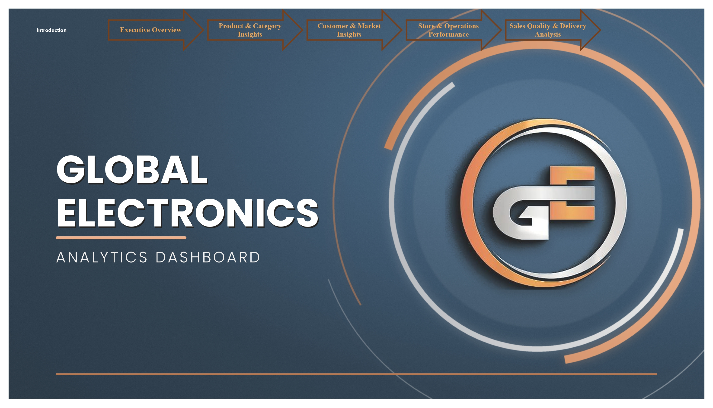
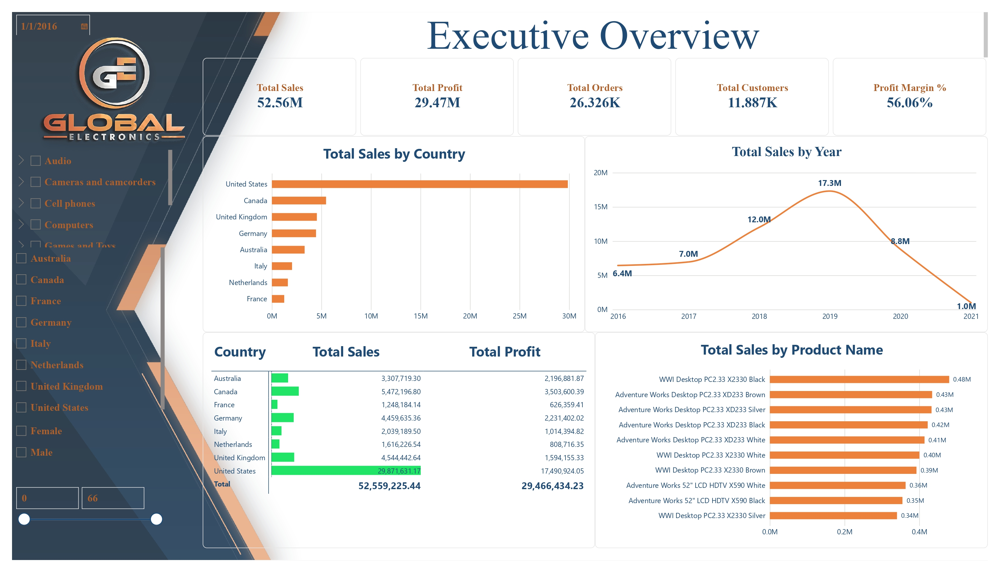
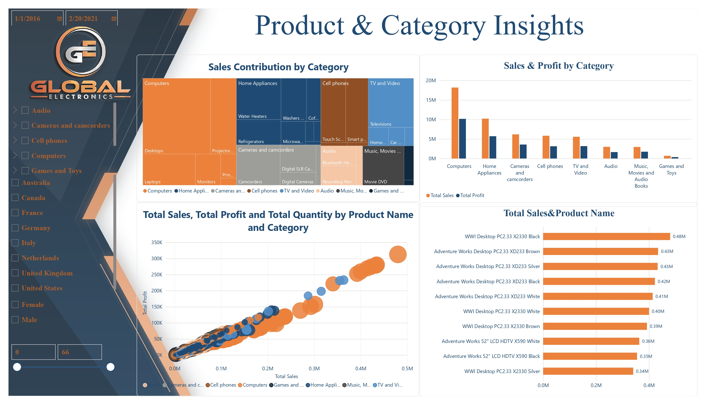
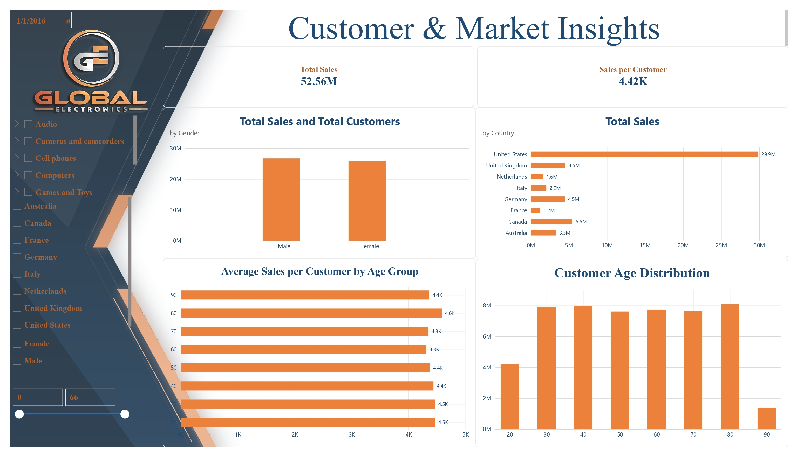
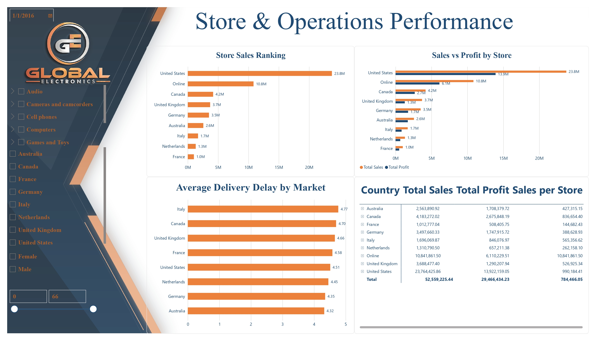
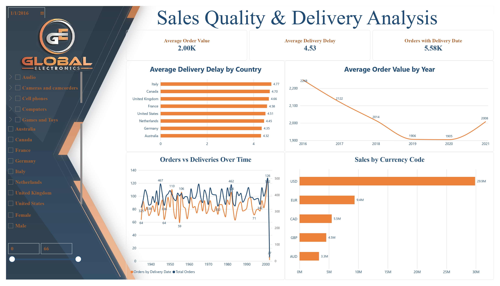

# 💻 Global Electronics – Analytics Dashboard (Power BI)



A Power BI project that analyzes global retail performance across categories, products, customers, stores, and markets, covering sales, profit, orders, customer demographics, and delivery efficiency[cite: 6, 7, 8, 9, 10, 11].

In this project, I imported the data into Power BI, cleaned and transformed it using Power Query, and built an interactive 6-page report with page navigation, slicers, and a custom branded design[cite: 6, 7, 10].

---

## 🎯 Project Objective

To build an interactive retail analytics report that helps management answer questions such as:

- 💰 How much did we sell, and how much profit did we make across years and markets[cite: 7]?
- 💻 Which categories and products drive the most sales and profit[cite: 8]?
- 👥 Who are our customers, and how is spending distributed across age groups and gender[cite: 9]?
- 🏬 How do physical stores compare to the Online channel in sales and profitability[cite: 10]?
- 🚚 What is our average order value, and how long does order delivery take across different countries[cite: 11]?

---

## 🛠️ Tools Used

- 📊 **Microsoft Power BI Desktop** – data modeling, DAX measures, visualization, navigation, and interactivity
- 🔄 **Power Query** – data import, transformation, and preparation
- 🧹 **Data Cleaning** – handling missing values, data types, and operational logic

---

## 🧹 Data Preparation

The data was imported into Power BI and prepared using Power Query.

The preparation included:

- 🔍 Reviewing the dataset structure, relationships, and column data types
- 🧹 Cleaning inconsistent and missing values (such as empty delivery dates for in-store purchases)
- 📅 Preparing date fields (`Order Date`, `Delivery Date`, and customer age groups)[cite: 9, 11]
- 🏷️ Standardizing product, category, store, country, and currency fields[cite: 7, 8, 10, 11]
- 🧮 Creating DAX measures for Total Sales, Total Profit, Profit Margin %, Average Order Value (AOV), Sales per Store, and Average Delivery Delay[cite: 7, 9, 10, 11]

---

## 📊 Report Pages

### 1️⃣ Executive Overview

A high-level summary of overall business performance[cite: 7].

- 💰 Total Sales, Total Profit, Total Orders, Total Customers, Profit Margin %[cite: 7]
- 🌍 Total Sales by Country[cite: 7]
- 📈 Total Sales by Year (2016–2021)[cite: 7]
- 📋 Country summary table (Total Sales & Total Profit)[cite: 7]
- 🏆 Top 10 Products by Total Sales[cite: 7]
- 🎛️ Slicers: Date Range, Category, Country, Gender[cite: 7]



---

### 2️⃣ Product & Category Insights

Focuses on product categories, subcategories, and top-performing items[cite: 8].

- 📦 Sales Contribution by Category & Subcategory (Treemap)[cite: 8]
- 📊 Sales & Profit by Category[cite: 8]
- 🔵 Total Sales, Total Profit, and Total Quantity by Product Name and Category (Scatter Chart)[cite: 8]
- 🏆 Top 10 Products by Total Sales[cite: 8]



---

### 3️⃣ Customer & Market Insights

Analyzes customer demographics, purchasing behavior, and geographic distribution[cite: 9].

- 💰 Total Sales and Sales per Customer KPI cards[cite: 9]
- 🌍 Total Sales and Total Customers by Country[cite: 9]
- 🚻 Total Sales by Gender (Male vs. Female)[cite: 9]
- 👥 Average Sales per Customer by Age Group[cite: 9]
- 📊 Customer Age Distribution (20 to 90)[cite: 9]



---

### 4️⃣ Store & Operations Performance

Compares physical store markets, the Online channel, and operational performance[cite: 10].

- 🏬 Store Sales Ranking (Physical Countries vs. Online Store)[cite: 10]
- 📊 Sales vs. Profit by Store Market[cite: 10]
- 🚚 Average Delivery Delay by Market[cite: 10]
- 📋 Store performance matrix (Total Sales, Total Profit, Sales per Store)[cite: 10]



---

### 5️⃣ Sales Quality & Delivery Analysis

Examines order value trends, shipping lead times, and currency breakdown[cite: 11].

- 💵 Average Order Value, Average Delivery Delay, and Orders with Delivery Date KPI cards[cite: 11]
- 🚚 Average Delivery Delay by Country[cite: 11]
- 📉 Average Order Value (AOV) by Year[cite: 11]
- 📈 Orders vs. Deliveries Over Time[cite: 11]
- 💱 Sales by Currency Code (`USD`, `EUR`, `CAD`, `GBP`, `AUD`)[cite: 11]



---

## 🎛️ Interactive Features

- 🎛️ Slicers: Date Range, Category (with Subcategory hierarchy), Country, Gender, and Age slider[cite: 7, 8, 10, 11]
- 🔍 Cross-filtering between visuals
- 🧭 Dedicated Introduction cover page and page navigation[cite: 6]
- 🎨 Custom dark-navy and orange branded UI design (`GE - Global Electronics`)[cite: 6, 7, 10]

---

## 📌 Key Results

| KPI | Result |
|---|---:|
| 💰 Total Sales | **$52.56M**[cite: 7] |
| 💵 Total Profit | **$29.47M**[cite: 7] |
| 📊 Profit Margin % | **56.06%**[cite: 7] |
| 🛒 Total Orders | **26.33K**[cite: 7] |
| 👥 Total Customers | **11.89K**[cite: 7] |
| 💳 Sales per Customer | **$4.42K**[cite: 9] |
| 🛍️ Average Order Value (AOV) | **$2.00K**[cite: 11] |
| 🚚 Average Delivery Delay | **4.53 Days**[cite: 11] |
| 📦 Orders with Delivery Date | **5.58K**[cite: 11] |

> Figures are as displayed in the report[cite: 7, 9, 11].

---

## 💡 Key Insights

- 🌍 **United States** dominated sales by country with **$29.87M** in sales and **$17.49M** in profit (about **56.8%** of total revenue), followed by **Canada** (**$5.47M**), **United Kingdom** (**$4.54M**), and **Germany** (**$4.46M**)[cite: 7].
- 📈 **Yearly Sales Trend:** Sales grew steadily from **$6.4M** in 2016 to a peak of **$17.3M** in 2019, before dropping to **$8.8M** in 2020 and **$1.0M** in early 2021[cite: 7, 8].
- 💻 **Computers** was the #1 category by sales (**~$18M+**) and profit (**~$10M**), led by Desktops, Laptops, Monitors, and Projectors, followed by **Home Appliances** (**~$10M** in sales)[cite: 8].
- 🏆 The top product by sales was **WWI Desktop PC2.33 X2330 Black** (**$0.48M**), followed by **Adventure Works Desktop PC2.33 XD233 Brown & Silver** (**$0.43M** each)[cite: 7, 8].
- 🏬 **Store vs. Online Channels:** In-store US locations generated **$23.76M**, while the **Online** store was the second-largest channel overall with **$10.84M** in sales and **$6.11M** in profit across **5.58K** delivered orders[cite: 10, 11].
- 👥 **Customer Demographics:** Sales were evenly split between **Male** and **Female** customers[cite: 9]. Average spending per customer remained consistent across age brackets at **$4.3K–$4.6K**, with core customer volume concentrated between ages **30 and 80**[cite: 9].
- 🚚 **Delivery Efficiency:** The overall average delivery delay was **4.53 days**[cite: 11]. **Australia** (**4.32 days**) and **Germany** (**4.35 days**) had the fastest delivery times, while **Italy** (**4.77 days**) and **Canada** (**4.70 days**) experienced the longest delays[cite: 10, 11].
- 💱 **Currency Distribution:** **USD** accounted for **$29.9M** in sales, followed by **EUR** (**$9.4M**), **CAD** (**$5.5M**), **GBP** (**$4.5M**), and **AUD** (**$3.3M**)[cite: 11].

---

## 🔄 Workflow

```text
Raw Data
   ↓
📥 Import Data (Power BI)
   ↓
🧹 Power Query – Cleaning & Transformation
   ↓
🗂️ Data Model & DAX Measures
   ↓
📊 Visuals & KPIs
   ↓
🎛️ Interactive 6-Page Report
   ↓
💡 Business Insights


## 👩‍💻 Author

**Eman Sayed Seddik**
🔗 [LinkedIn](https://www.linkedin.com/in/eman-sayed-seddik-59bb1616a/)
